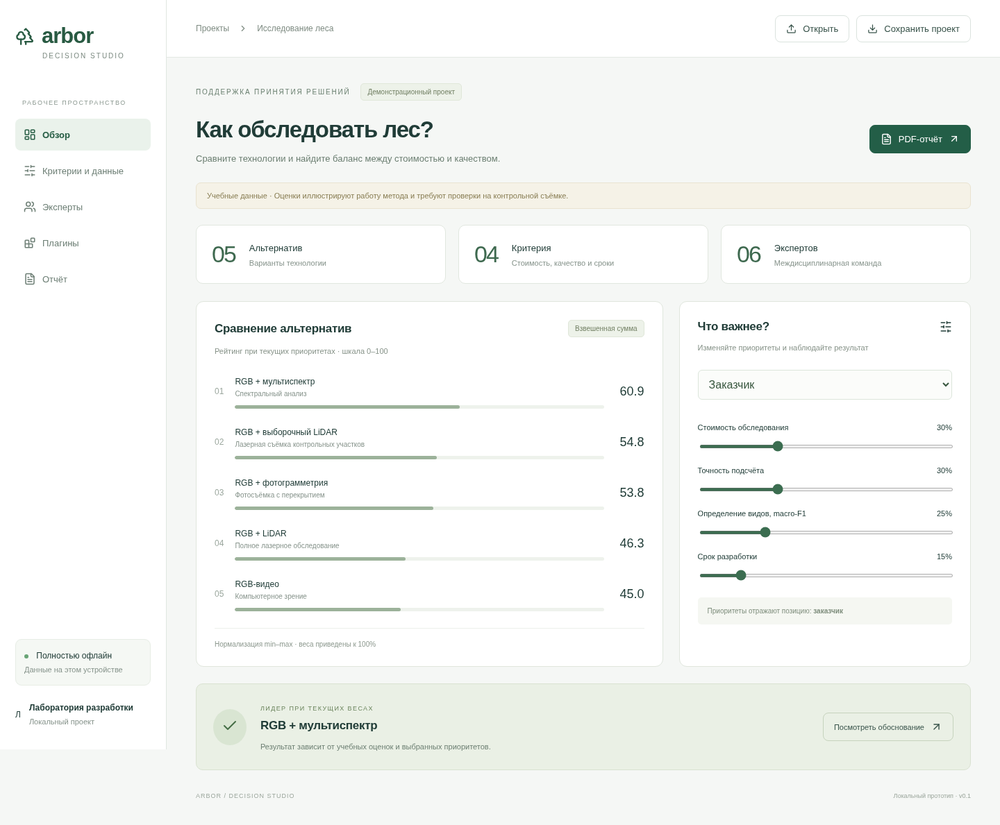

# Arbor — Decision Studio

Офлайн-приложение для поддержки решений в лаборатории разработки программных и технических систем. Основная поставка — настольное приложение Electron для Windows и macOS со встроенным движком, без установки зависимостей пользователем.



## Статус

Ранний прототип. Пример сравнивает пять технологий обследования деревьев с беспилотника: RGB-видео, фотограмметрию, мультиспектральную съёмку, LiDAR и выборочное использование LiDAR. Все значения учебные, не результаты измерений оборудования.

Работают взвешенная сумма с min–max-нормализацией, редактирование оценок и весов, два профиля приоритетов, анализ чувствительности, локальное автосохранение, импорт/экспорт проекта JSON и PDF. Шесть экспертных ролей пока представлены списком; индивидуальные оценки не реализованы.

Внешние WASM-плагины пока имеют экспериментальный контракт `score(f64) -> f64`, преобразующий итоговые баллы. Исполнение — в отдельном worker с таймаутом 2 секунды, размер файла до 5 МБ; лимита памяти нет. Плагины не сохраняются между запусками. Полноценный API методов планируется отдельно.

## Запуск пользователем

- Windows x64: полностью распаковать архив и запустить `Arbor.exe`. Соседние файлы обязательны.
- Mac Apple Silicon / Intel: распаковать подходящий архив и открыть `Arbor.app`.
- Интернет, браузер, Node.js, Rust и отдельные библиотеки не нужны.
- Автосохранение находится в профиле пользователя ОС. Для переноса задачи использовать «Сохранить проект» / «Открыть».
- PDF: меню «Файл → Сохранить отчёт в PDF».

С версии 0.1.1 Mac-пакеты подписываются ad-hoc на macOS. CI распаковывает каждый Mac ZIP, проверяет `codesign --verify --deep --strict` и запускает приложение с проверкой интерфейса, автосохранения, WASM и PDF. Это не подпись Developer ID и не нотариализация: Gatekeeper всё ещё может блокировать запуск. Windows-пакет без подписи. macOS 13 или новее.

Архивы приложений предназначены для GitHub Releases, а не истории Git. Workflow сохраняет новые архивы как Actions artifacts.

## Разработка

Node.js 24, npm:

```sh
npm ci
npm test
npm run dev
```

Веб-интерфейс разработчика: http://localhost:5173. `npm run build` создаёт веб-сборку. `npm run build:portable` — автономный HTML как дополнительный вариант, не основная настольная поставка.

```sh
npm run desktop:build:windows
npm run desktop:build:mac-arm
npm run desktop:build:mac-intel
python3 scripts/archive-desktop.py
```

Результаты — в `release/`. Последняя команда архивирует все три заранее собранных варианта, требует Python 3.11+ и `zip`. На Linux `npm run desktop` запускает настольную сборку при наличии графического сеанса. На macOS сборка подписи требует отдельной настройки Apple Developer.

При необходимости использования унаследованного прокси Node.js: `NODE_USE_ENV_PROXY=1`. Разработчику требуется интернет для установки npm-пакетов и загрузки Electron; конечному пользователю — нет.

## Структура

- `src/` — React-интерфейс, расчёты и WASM-worker.
- `desktop/main.cjs` — Electron: изоляция renderer, блокировка сетевых запросов и новых окон, PDF.
- `scripts/` — сборка, упаковка и проверки в браузере.
- `tests/` — контрольные математические примеры.
- `src-tauri/` — первоначальный экспериментальный каркас, не используется в текущей поставке.

Проверки: `npm test`, `npm run build`; для браузерных проверок сначала `npx playwright install chromium`. `node scripts/smoke.mjs` требует запущенного dev-сервера, `node scripts/portable-smoke.mjs` проверяет автономный HTML без сети.

## План развития

1. Редактор альтернатив, критериев, обязательных ограничений и экспертных оценок.
2. Полный версионированный API плагинов: манифест, схема параметров, передача матрицы, ограничения памяти, постоянная установка, совместимость.
3. AHP, TOPSIS, CSV с сопоставлением столбцов.
4. SQLite, миграции, снимки расчётов и резервные копии.
5. Проверка на чистых Windows/macOS, подпись и нотариализация установочных пакетов.
